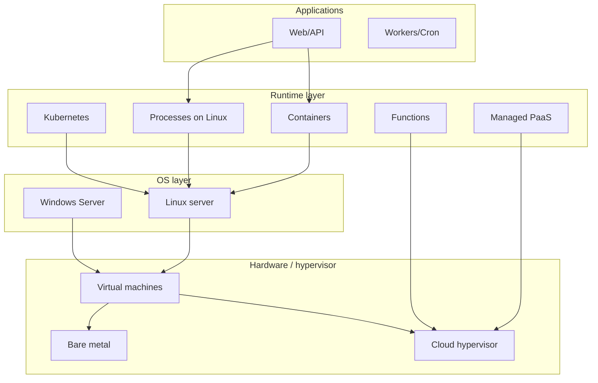

# Part 0 — Glossary & infrastructure map

---

## Platform stack map (where Linux sits)

---

## Glossary

| Term | Meaning |
|------|---------|
| **DevOps** | Practices + culture: fast, reliable delivery through automation and shared ownership |
| **DevSecOps** | Security practices integrated into DevOps (shift left) |
| **SRE** | Site Reliability Engineering — Google-style ops with error budgets |
| **Platform engineering** | Internal platforms (IDP) for dev self-service |
| **IaaS** | Rent VMs, networks, disks (you patch OS) |
| **PaaS** | Rent runtime; provider patches platform |
| **SaaS** | Use product over network |
| **Shared responsibility** | Provider secures cloud; you secure data, IAM, app |
| **CI** | Continuous Integration — merge code with automated checks |
| **CD** | Continuous Delivery/Deployment — automated release path |
| **IaC** | Infrastructure as Code — Terraform, Pulumi |
| **Cm** | Configuration management — Ansible, cloud-init |
| **Immutable infra** | Replace servers instead of SSH-patching in place |
| **Golden image** | Pre-hardened VM template |
| **Container** | Process isolation with images (Docker/OCI) |
| **Orchestration** | Scheduling many containers (Kubernetes) |
| **GitOps** | Git as desired state; controllers reconcile cluster |
| **Reverse proxy** | nginx/Caddy in front of app servers |
| **TLS termination** | HTTPS handled at proxy/load balancer |
| **IAM** | Identity & access (users, roles, policies) |
| **SBOM** | Software bill of materials — dependency inventory |
| **SCA** | Software composition analysis — vuln in deps |
| **SAST** | Static analysis on source |
| **DAST** | Dynamic analysis on running app |
| **CIS benchmark** | Hardening checklist for OS |
| **RPO/RTO** | Recovery point/time objectives |
| **DORA metrics** | Deploy freq, lead time, MTTR, change fail rate |

---

## Linux vs “everything else” (one sentence each)

| Platform | Role |
|----------|------|
| **Linux server** | Default for self-hosted apps, containers, cloud VMs |
| **WSL2** | Linux kernel on Windows for **learning/dev**; not production hosting |
| **Windows Server** | AD, IIS, .NET legacy, some enterprise stacks |
| **macOS** | Developer laptop; rarely production server |
| **Cloud PaaS** | Heroku, Render, Fly, Vercel — less OS toil |
| **Managed K8s** | EKS/GKE/AKS — you own manifests, they own control plane |
| **Serverless** | Lambda/Cloud Functions — no VM management |

Deep comparison: [Part 2](02-linux-vs-other-infrastructure.md).

---

## Artifact map (DevOps documents)

| Artifact | Purpose |
|----------|---------|
| Runbook | How to operate & fix |
| Pipeline spec | CI/CD stages & gates |
| Infra ADR | Why Terraform vs clickops |
| Threat model lite | Assets, threats, controls |
| Server baseline | Hardening checklist |

Templates in `/templates`.

Next: [Part 1 — DevOps mindset](01-devops-mindset-lifecycle.md)
