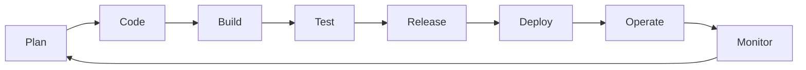

# Part 1 — DevOps Mindset & Lifecycle

---

## What DevOps is not

- Not “hire one DevOps person to fix ops”
- Not “only Docker”
- Not “no documentation”
- Not “SSH and pray” in production

DevOps is **how** teams (or solo you wearing two hats) shorten the path from idea to running software **safely and repeatably**.

---

## CALMS (culture model)

| Letter | Meaning | Solo practice |
|--------|---------|---------------|
| **C**ulture | Blameless learning | Post-incident notes in runbook |
| **A**utomation | Repeatable pipelines | GitHub Actions, Ansible |
| **L**ean | Small batches | Ship staging daily |
| **M**easurement | Metrics | Deploy count, uptime |
| **S**haring | Tools & knowledge | Runbooks in git |

---

## Software delivery lifecycle (SDLC) with ops

| Phase | DevOps focus |
|-------|----------------|
| Plan | Environments, SLOs, threat model lite |
| Code | Lint, pre-commit, secrets scan |
| Build | Reproducible artifacts (binaries, images) |
| Test | Unit, integration, security gates |
| Release | Version tags, changelog |
| Deploy | Automated, rollback path |
| Operate | Runbooks, on-call (you) |
| Monitor | Alerts, logs |

---

## Dev vs Ops vs DevOps (solo)

| Hat | Questions |
|-----|-----------|
| **Dev** | Does feature work? |
| **Ops** | Will it stay up? Can I restore? |
| **DevOps** | Can I ship Friday without fear? |

Same person; switch hats explicitly in checklists ([server baseline](../templates/server-baseline.md)).

---

## DORA metrics (targets for learning)

| Metric | What it measures | Solo starter goal |
|--------|------------------|-------------------|
| Deployment frequency | How often you deploy | ≥ weekly staging |
| Lead time for changes | Commit → prod | Track days, shrink |
| MTTR | Mean time to restore | < 1 h with runbook |
| Change failure rate | Deploys causing incident | < 15% |

---

## Toil vs engineering

**Toil:** manual, repetitive, scales with load (clicking console, manual SSH edits).  
**Goal:** automate or eliminate toil; spend time on reliability features.

Rule: if you do it **three times**, script it or IaC it.

---

## Relationship to DevSecOps & SRE

- **DevSecOps** — add security gates in Plan/Code/Build/Test (Part 21+)  
- **SRE** — SLOs, error budgets, capacity (Parts 18–19)  

Next: [Part 2 — Linux vs other infrastructure](02-linux-vs-other-infrastructure.md)
