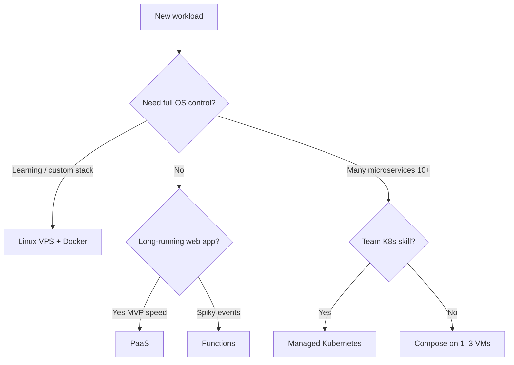

# Part 2 — Linux vs Other Infrastructure

This chapter answers: **what runs where**, and **what you must learn** for each.

---

## Comparison matrix

| Dimension | Linux VM (VPS) | Windows Server | Docker on Linux | Kubernetes | PaaS (Render/Vercel) | Serverless |
|-----------|----------------|----------------|-----------------|------------|----------------------|------------|
| You patch OS | Yes | Yes | Host only | Nodes yes | No | No |
| SSH/RDP | SSH | RDP | SSH to host | kubectl/API | Dashboard/git | Console/IaC |
| Typical cost | $ | $$ | $–$$$ | $$$ | $–$$ | Pay per use |
| Control | High | High | High | Very high | Low | Lowest |
| Best for | Full control, learning | .NET/IIS/AD | Portable apps | Many services | Fast MVP | Event spikes |
| DevSecOps surface | Full stack | Full + AD | Image + host | Cluster + images | Provider + app | IAM + code |

**Default learning path:** Linux VPS + Docker Compose → then cloud IaC → K8s only if needed.

---

## Linux in production

**Why most infra tutorials assume Linux:**

- Dominant server OS for web, APIs, data pipelines
- Containers run Linux cgroups/namespaces (Windows containers exist but niche)
- Cloud VMs default to Ubuntu/Debian/RHEL AMIs
- Tooling (systemd, nginx, iptables/nftables) is documented at scale

**You learn:** shell, package manager, systemd, file permissions, sshd, ufw, journald.

---

## WSL2 (your dev machine) vs Linux server

| | WSL2 | Production Linux VPS |
|--|------|----------------------|
| Purpose | Dev, local tools | Serves users 24/7 |
| Init | Windows starts WSL | systemd PID 1 |
| Networking | NAT via Windows | Public IP, firewalls |
| Persistence | Can stop with Windows | Always on or autoscale |
| systemd | Yes (recent WSL) | Yes |
| “Same commands?” | Mostly | Yes — **deploy target should be VPS**, not WSL |

**Practice:** develop in WSL2; **deploy** to Ubuntu 24.04 VPS to learn real networking and TLS.

---

## macOS vs Linux (dev laptop)

- macOS: BSD-ish userland, Docker Desktop, `brew`  
- Production: still usually **Linux**  
- Pitfall: case-sensitive FS, different paths — use containers for parity.

---

## Windows Server (when it appears)

- Active Directory, Group Policy  
- IIS, ASP.NET Framework (legacy)  
- SQL Server on Windows  
- **Ops model:** RDP, Windows Update, PowerShell DSC / Ansible winrm  

See [Part 27 — Windows contrast](27-windows-infra-contrast.md).

---

## Cloud “abstracted Linux”

| Service | You think in… | Hidden Linux |
|---------|---------------|--------------|
| EC2 / GCE VM | Ubuntu AMI | Full Linux |
| ECS Fargate | Task definition | Linux managed |
| Cloud Run | Container | Linux managed |
| Lambda | Handler code | Amazon Linux |

Even “serverless” often runs on Linux — you just do not SSH.

---

## Choosing a platform (decision tree)

Document choice in [infra ADR](../templates/infra-decision-record.md).

---

## Hybrid reality (common solo/small team)

- **Frontend:** Vercel/Cloudflare (PaaS)  
- **API + DB:** Linux VPS or managed RDS  
- **Workers:** container on same VPS or queue + Lambda  

Each piece has different patching and security model — map in threat model.

Next: [Part 3 — Linux essentials](03-linux-essentials.md)
