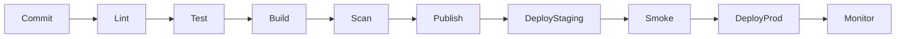

# Part 7 — CI/CD Pipelines

Template spec: [templates/cicd-pipeline-spec.md](../templates/cicd-pipeline-spec.md)

---

## Pipeline stages



| Stage | Fail if |
|-------|---------|
| Lint | style/types broken |
| Test | assertions fail |
| Build | compile/docker build fail |
| Scan | critical CVE (policy) |
| Deploy | health check fail |

---

## GitHub Actions skeleton

```yaml
name: ci
on:
  push:
    branches: [main]
  pull_request:
jobs:
  test:
    runs-on: ubuntu-latest
    steps:
      - uses: actions/checkout@v4
      - uses: actions/setup-node@v4
        with:
          node-version: "22"
      - run: npm ci
      - run: npm test
      - run: npm run build
```

Deploy job: separate workflow, `workflow_dispatch` or tag `v*`, environment **production** with approval.

---

## Artifacts

- **Containers:** push to GHCR, ECR, Docker Hub  
- **Static sites:** upload to S3/R2 or rsync to VPS  
- **Binaries:** attach to GitHub Release  

Immutable tag: `git sha` or semver — never `:latest` only in prod.

---

## Deployment hooks

- **Pre-deploy:** DB migration job  
- **Post-deploy:** smoke `curl -f https://staging/health`  
- **Rollback:** previous image tag or `terraform apply` previous state  

---

## CD vs Continuous Deployment

| Continuous Delivery | Continuous Deployment |
|---------------------|------------------------|
| Always releasable | Auto to prod on green main |
| Manual prod button | No manual gate |

Solo: auto **staging**, manual or tagged **prod** until confident.

Next: [Part 8 — Docker & Compose](08-containers-docker-compose.md)
