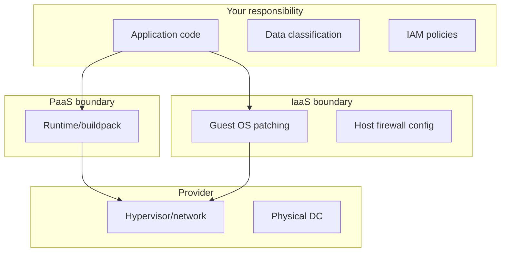

# Part 12 — IaaS, PaaS & SaaS Models

---

## Stack diagram

---

## Shared responsibility (AWS-style)

| Area | You | Provider |
|------|-----|----------|
| Physical | | ✅ |
| Hypervisor | | ✅ |
| Network config | ✅ | partial |
| OS on EC2 | ✅ | |
| App | ✅ | |
| Managed RDS | patches DB engine | you: SQL, users |
| Lambda | code | runtime patch |

**DevSecOps:** your side includes identity, secrets, app vulns, data encryption choices.

---

## When to pick each

| Need | Pick |
|------|------|
| Learn Linux ops | IaaS VPS |
| Ship fast, low traffic | PaaS |
| Email/calendar | SaaS (Google) |
| Custom kernel modules | IaaS bare metal |
| Compliance data residency | IaaS region choice + your controls |

---

## Vendor lock-in vs velocity

PaaS speeds MVP; export strategy = containers + Postgres dumps + IaC modules.

Document in infra ADR.

Next: [Part 13 — Terraform](13-terraform-iac.md)
