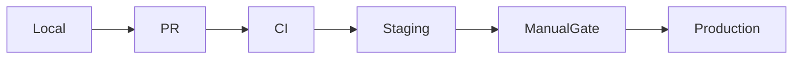

# Part 17 — Environments & Promotion

---

## Standard tiers

| Env | Purpose | Data | URL |
|-----|---------|------|-----|
| **local** | dev | fake | localhost |
| **staging** | pre-prod test | anonymized | staging.* |
| **production** | users | real | app.* |

Optional: **preview** per PR (PaaS).

---

## Promotion flow

**Parity:** staging mirrors prod topology (same Compose services, smaller SKUs).

---

## Config per environment

| Anti-pattern | Fix |
|--------------|-----|
| Prod-only bugs | Same Docker image, different env vars |
| Secrets in repo | Secret manager / `.env` on server only |
| Schema drift | Migrations run staging before prod |

---

## Feature flags

Decouple deploy from release — flag off in prod until verified in staging.

Next: [Part 18 — Observability](18-observability.md)
