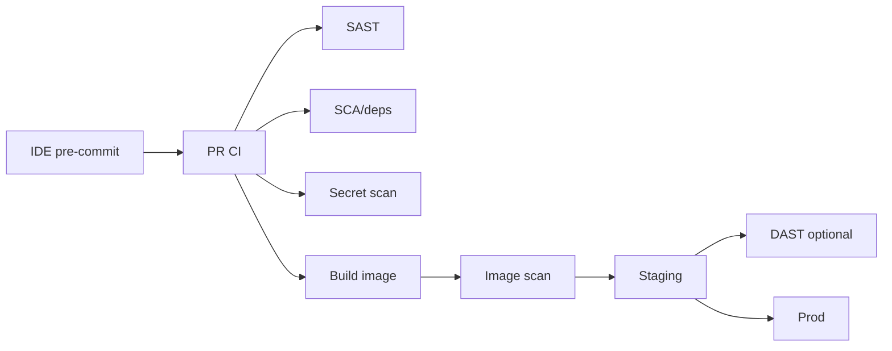

# Part 21 — DevSecOps & Shift Left

**Shift left:** find security issues **earlier** (cheaper) in SDLC.

---

## Pipeline security gates

---

## OWASP DevSecOps maturity (solo targets)

| Practice | Starter |
|----------|---------|
| Secret detection | gitleaks in CI |
| Dependency scan | Dependabot + `npm audit` / OSV |
| SAST | Semgrep or CodeQL |
| Container scan | Trivy on image |
| IaC scan | `tfsec`, `checkov` |
| Runtime | ufw, fail2ban, updates |

---

## Threat modeling lite

Template: [threat-model-lite.md](../templates/threat-model-lite.md)

STRIDE per component: Spoofing, Tampering, Repudiation, Info disclosure, DoS, Elevation.

---

## Security vs speed

| Myth | Reality |
|------|---------|
| Security blocks shipping | Automation blocks bad merges |
| Prod pen test enough | Shift left catches 80% early |
| Linux = secure | Hardening required |

---

## Policy examples (fail CI)

- Critical CVE in deps without waiver  
- gitleaks hit  
- Dockerfile `USER root` in prod image (custom rule)  

Next: [Part 22 — Linux hardening](22-linux-hardening.md)
