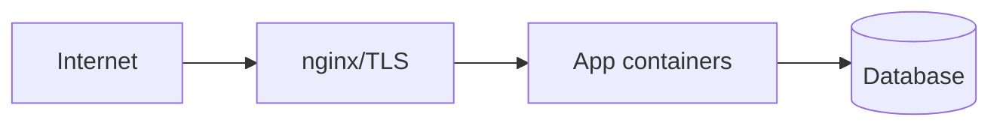

# Threat model (lite) — {{SYSTEM}}

**Date:**  
**Author:**

---

## Assets

| Asset | Sensitivity |
|-------|-------------|
| User PII | High |
| API keys | High |
| Source code | Medium |
| Uptime | Medium |

---

## Trust boundaries

---

## STRIDE (top risks)

| Threat | Component | Mitigation | Status |
|--------|-----------|------------|--------|
| Spoofing | API | JWT/OAuth, mTLS | |
| Tampering | DB | TLS, least privilege user | |
| Repudiation | Admin actions | Audit log | |
| Info disclosure | Backups | Encryption at rest | |
| DoS | Edge | rate limit, CDN | |
| Elevation | SSH | keys, fail2ban, no root | |

---

## DevSecOps controls mapped

| Control | Pipeline stage |
|---------|----------------|
| gitleaks | PR |
| Trivy | build |
| ufw | runtime |

---

## Open items

| # | Risk | Owner | Due |
|---|------|-------|-----|
| 1 | | | |
